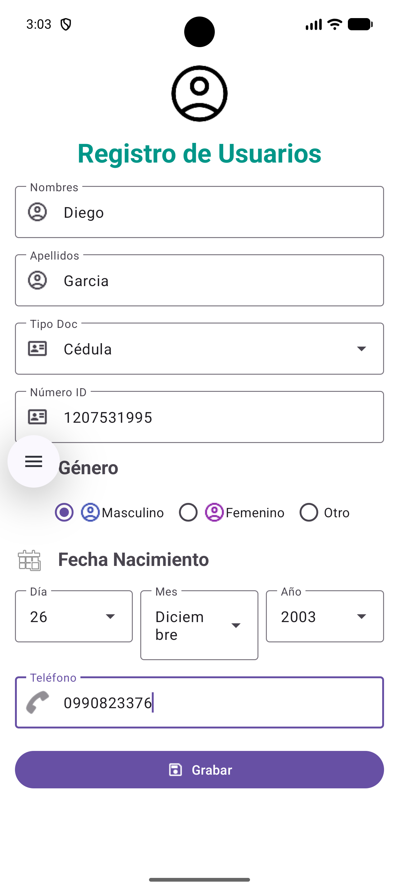

# Práctica 2 - Registro de Usuarios
Aplicación Android desarrollada en **Java** que muestra un formulario de **Registro de Usuarios**. La interfaz está construida con `ConstraintLayout` dentro de un `ScrollView` y utiliza componentes de **Material Design 3**.

  

## Campos del formulario

| Campo | Componente | Descripción |
|---|---|---|
| Nombres | `TextInputLayout` + `TextInputEditText` | Texto con icono de usuario |
| Apellidos | `TextInputLayout` + `TextInputEditText` | Texto con icono de usuario |
| Tipo de documento | `MaterialAutoCompleteTextView` | Lista desplegable: Cédula, Pasaporte, RUC |
| Número ID | `TextInputEditText` | Solo números, máximo 10 dígitos |
| Género | `RadioGroup` + `RadioButton` | Masculino, Femenino u Otro |
| Fecha de nacimiento | `LinearLayout` horizontal | Tres listas desplegables: Día, Mes y Año |
| Teléfono | `TextInputEditText` | Teclado telefónico |
| Grabar | `Button` | Botón con icono de guardar |

## Detalles técnicos

- **Lenguaje:** Java
- **Pantalla principal:** `registrodeusuario` (configurada como `LAUNCHER` en el `AndroidManifest.xml`)
- **Diseño:** `app/src/main/res/layout/activity_registrodeusuario.xml`
- **Layouts utilizados:**
  - `ScrollView`: permite desplazar el formulario en pantallas pequeñas.
  - `ConstraintLayout`: posiciona cada elemento en relación con los demás.
  - `LinearLayout` con `layout_weight`: reparte el ancho de Día, Mes y Año en partes iguales.
- **Recursos:** las opciones de las listas desplegables están definidas como `<string-array>` en `res/values/strings.xml` (`tipo_doc`, `dia`, `mes`, `anio`).
- **Iconos:** imágenes PNG ubicadas en `res/drawable` (`user100`, `usuario`, `cedula`, `genero`, `guardar`).
- **SDK:** mínimo 30 (Android 11), objetivo 37.

